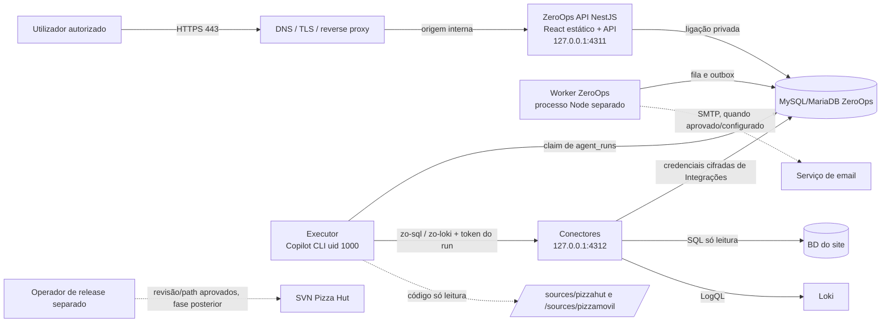
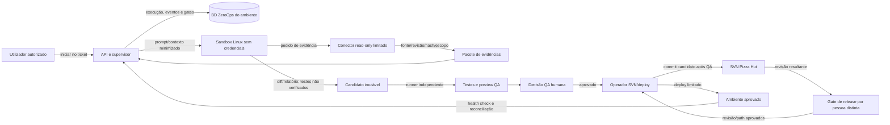

# Arquitetura ZeroOps na infraestrutura Pizza Hut

## Estado deste documento

Esta arquitetura descreve o deployment confirmado em Qualidade, não uma autorização para operar em Produção. Em 9 de novembro de 2026, o host QA `uqphorders24-dev` executava os contentores API, worker, connectors e executor; a migração de Saúde 004 estava aplicada e `/v1/health` dos conectores respondia `ready`. A página Saúde ainda não tinha configuração, amostras de agente nem SMTP. Produção não foi consultada nem alterada.

O portal e o workflow usam a base ZeroOps própria de cada ambiente. O conector de investigação continua read-only. Alterações de schema/dados em QA, quando implementadas, usarão uma fronteira separada, limitada a tickets aprovados, auditada e sem credenciais expostas ao modelo. A monitorização de Produção será somente de leitura e requer autorização específica para consultas reais; não existe caminho de escrita em Produção.

## Arquitetura da aplicação atual

O repositório define:

- Portal React compilado em `apps/web/dist`.
- API NestJS/Express em Node.js 24 ou superior. A API serve o frontend compilado e escuta, por omissão, em `127.0.0.1:4311`.
- Worker Node separado, responsável pela fila/outbox de notificações.
- MySQL/MariaDB dedicado, configurado através de `ZEROOPS_DATABASE_URL`; API e worker usam a base do respetivo ambiente.
- Migrações SQL executadas explicitamente, fora dos pedidos HTTP.
- Executor (`apps/executor`): consome `agent_runs`, lança o Copilot CLI com uid sem privilégios num contentor com workspace tmpfs e código do site só de leitura. O token Copilot vem da integração `copilot` do projeto, cifrada na BD. Por omissão usa o `@github/copilot-sdk`: os eventos da sessão (texto, ferramentas, MCP, perguntas) ficam em `agent_run_events` e chegam ao browser por SSE (`/api/tickets/:id/agent-runs/:runId/events/stream`); respostas e mensagens da equipa entram por `agent_run_inputs`. As permissões do agente são decididas pela `PermissionPolicy` (leitura das fontes, escrita só do relatório, shell só `zo-sql`/`zo-loki`, MCP só leitura, sem URLs).
- Serviço de conectores (`apps/connectors`, `127.0.0.1:4312`): executa `zo-sql`/`zo-loki` em nome do run ativo, com credenciais das integrações `database`/`telemetry` verificadas na página Integrações; nunca as entrega ao agente.
- Supervisor multiagente, escrita governada na BD de QA e operador de release continuam por implementar.

O proxy HTTPS deve ser a única entrada pública. Não publicar a porta interna da API nem servir diretamente o checkout do repositório. A raiz inclui regras que negam a publicação direta dos ficheiros do checkout.

O frontend e a API devem ser apresentados sob a mesma origem HTTPS do ZeroOps, com o proxy a encaminhar os pedidos para a API local. Isso evita expor a porta Node e simplifica a validação de origem, cookies e CSRF. Um hostname ou serviço de estáticos separado só deve ser introduzido se houver uma necessidade validada.

O fluxo GenOps será ativado por etapas e somente a pedido de uma pessoa autorizada. Supervisor/modelo, conector read-only, sandbox e operador SVN são fronteiras de segurança distintas. O modelo não recebe credenciais de origem nem chama o operador diretamente.

## Alvos de alojamento

### Qualidade

| Endereço fornecido                                       | Papel indicado                                    | Proposta                                                                                                                                                                               |
| -------------------------------------------------------- | ------------------------------------------------- | -------------------------------------------------------------------------------------------------------------------------------------------------------------------------------------- |
| `192.168.90.79` — `uqphorders24-dev` — `dev.pizzahut.pt` | Servidor de Qualidade                             | Alvo candidato para API, frontend compilado e worker ZeroOps, atrás do proxy HTTPS aprovado.                                                                                           |
| Base de dados de Qualidade                               | MariaDB 10.3 local a `.79`, base `zeroops`        | Base e utilizador exclusivos do ZeroOps (credenciais em `/root/.zeroops/zeroops-mysql.cnf`, fora do webroot), separados da base do site. Nunca apontar para a BD de Produção.          |
| URL do portal QA                                         | `tickets.pizzahut.pt` (escolhido pelo utilizador) | Usar localmente uma entrada `hosts` na máquina de teste a apontar para `.79`, apenas após validar conflitos, vhost e certificado HTTPS confiável. Não alterar DNS público de Produção. |

Qualidade deve usar uma base isolada e dados próprios de teste. Os serviços podem ser instalados em `.79` apenas depois de confirmar runtime Node 24, gestor de serviços, proxy, recursos e regras de firewall. O mapeamento local de `hosts` apenas encaminha o browser desta máquina; não configura DNS, proxy, serviço ou certificado e não torna a aplicação publicamente acessível.

### Produção

| Endereço fornecido                                            | Papel indicado    | Proposta                                                                                                                                                                                                                                                          |
| ------------------------------------------------------------- | ----------------- | ----------------------------------------------------------------------------------------------------------------------------------------------------------------------------------------------------------------------------------------------------------------- |
| `172.16.1.112` — `uqphorders21-web` — `frontend.pizzahut.pt`  | Web/frontend      | Candidato preferencial para o proxy público e, se autorizado e suportado, API e worker ZeroOps como serviços Node separados.                                                                                                                                      |
| `172.16.1.110` — `uqphorders22-db` — `backend.pizzahut.pt`    | DB/backend        | Candidato a MySQL/MariaDB dedicado do ZeroOps, sujeito a aprovação de capacidade, isolamento e rede. Evitar instalar API/worker num servidor cuja função primária é base de dados. O alias `backend.pizzahut.pt` não confirma que seja o endpoint da API ZeroOps. |
| `172.16.1.109` — `uqphorders23-static` — `static.pizzahut.pt` | Conteúdo estático | Opcional. A primeira versão pode servir o frontend compilado pela API; usar este host apenas se a infraestrutura exigir ou beneficiar de origem estática separada.                                                                                                |
| URL da instância ZeroOps de Produção                          | Por definir       | Só definir após o piloto QA e inventário/aprovação do destino. Não reutilizar `tickets.pizzahut.pt` (QA local), `frontend.pizzahut.pt`, `backend.pizzahut.pt` ou `static.pizzahut.pt` sem confirmar serviços e aprovar a alteração.                               |

**Recomendação:** executar API e worker num nó de aplicação/web e manter o MySQL/MariaDB num nó/serviço de dados, sem os misturar com a aplicação de encomendas. `.112` e `.110` são candidatos pelos papéis indicados, não destinos confirmados. Se `.112` não puder executar Node 24, identificar um nó de aplicação autorizado em vez de colocar os processos da aplicação no servidor DB por conveniência.

Usar bases e utilizadores MySQL/MariaDB distintos em cada ambiente (por exemplo, `zeroops_qa` e `zeroops_prod`). A separação deve ser efetiva também ao nível de credenciais, backups, firewall e ciclo de vida; não basta criar um schema ZeroOps na base de encomendas. A primeira instalação e o primeiro piloto decorrem em Qualidade; Produção exige aprovação posterior específica.

## Comunicação e fronteiras de rede

| Origem                    | Destino                                                               | Necessidade                                                                                                                                        |
| ------------------------- | --------------------------------------------------------------------- | -------------------------------------------------------------------------------------------------------------------------------------------------- |
| Browser do utilizador     | Hostname dedicado ZeroOps, HTTPS/443                                  | Interface e API sob a mesma origem pública.                                                                                                        |
| Reverse proxy             | API ZeroOps em loopback, porta interna configurada (por omissão 4311) | Encaminhar HTTP interno; não expor a porta Node à rede.                                                                                            |
| API ZeroOps               | MySQL/MariaDB do mesmo ambiente                                       | Operações de tickets, utilizadores, propostas e histórico.                                                                                         |
| Worker ZeroOps            | MySQL/MariaDB do mesmo ambiente                                       | Fila/outbox; saída SMTP apenas depois de aprovada e configurada.                                                                                   |
| API/worker de Qualidade   | MySQL/MariaDB de Qualidade                                            | Acesso apenas à BD/role de Qualidade.                                                                                                              |
| API/worker de Produção    | MySQL/MariaDB dedicado de Produção                                    | Acesso apenas à BD/role de Produção, por rede privada e origem permitida.                                                                          |
| Conector ZeroOps dedicado | Fonte de diagnóstico autorizada                                       | Acesso read-only, escopado, temporário, limitado e auditado; começar por SVN/documentação/logs e fontes QA.                                        |
| Modelo Copilot            | Sistemas Pizza Hut                                                    | Sem acesso de rede direto, credenciais, BD de encomendas ou permissões de escrita. Recebe apenas contexto autorizado e minimizado pelo supervisor. |
| Operador de release       | Working copy SVN dedicada                                             | Commit/deploy só de paths e revisão aprovados, após QA e autorização de release da revisão resultante.                                             |
| ZeroOps                   | Escrita na base de encomendas Pizza Hut                               | **Nunca permitida ao agente; não faz parte da arquitetura de diagnóstico.**                                                                        |
| Agente de saúde (cron)    | ZeroOps `POST /api/monitoring/ingest`, HTTPS/443                      | Métricas do servidor do site a cada minuto, autenticadas por token Bearer `zoh_`; só leitura no servidor (`deploy/health-agent`).                  |
| Worker ZeroOps (Saúde)    | URLs públicos do site/app/APIs, BD do site e Loki do ambiente fonte   | Sondas HTTP e consultas só de leitura para a página Saúde; e-mails pelo SMTP configurado.                                                          |

As portas do MySQL/MariaDB, endereços internos e regras de firewall não são conhecidos e devem ser definidos pela equipa de infraestrutura; não os inferir a partir do hostname `backend.pizzahut.pt`. Não expor a BD à Internet. Restringir a origem às máquinas/serviços ZeroOps autorizados.

## Segredos, identidades e operação

- Injetar `ZEROOPS_DATABASE_URL`, `ZEROOPS_PUBLIC_URL` e restantes configurações por um mecanismo de segredos aprovado, fora do checkout e do webroot.
- Configurações de integrações geríveis na aplicação ficam cifradas na BD com AEAD, escopo por projeto/ambiente e auditoria. A chave-mestra, bootstrap da ligação DB e identidade mínima de serviço ficam fora da BD, do Git e do webroot; a chave que cifra uma BD não pode depender exclusivamente dessa mesma BD.
- Usar identidades de serviço sem login interativo e com privilégio mínimo; separar Qualidade, Produção, execução da aplicação, acesso à BD e publicação.
- Não usar root partilhado para executar API, worker, executor ou operador. A automação deve usar identidades individuais/de serviço, auditáveis e com privilégio mínimo; o executor nunca herda a identidade do operador.
- Não guardar passwords, chaves SSH, tokens, dumps ou ficheiros `.env` no repositório.
- Configurar serviços para arranque/paragem controlados, logs centralizados ou destinos aprovados, alertas, retenção e rotação operada pela infraestrutura.
- Fazer backups da BD MySQL ZeroOps e testar o restauro antes de aceitar dados reais.
- O worker atual marca entregas sem transporte configurado como bloqueadas. Email, recuperação de conta e notificações não ficam operacionais até SMTP/relay autorizado e testes de entrega.
- Copilot exige identidade empresarial, licença e política de contexto aprovadas. Credenciais introduzidas na app ficam cifradas e nunca voltam a ser apresentadas; OAuth/device-code dentro da app só após provar suporte oficial e armazenamento seguro. Até essa prova, não usar uma subscrição pessoal/conta partilhada nem enviar contexto.
- Executor Copilot, integrações de leitura e publicação automática continuam desativados até existirem sandbox, autorização, evidências e operador dedicados. A configuração da integração não ativa por si só a capacidade.

## Arquitetura GenOps pretendida — fases posteriores ao portal

Invariantes: investigação e início de execução são explícitos; um ticket tem no máximo uma execução ativa; duas investigações simultâneas por projeto e uma implementação por projeto; quatro gates humanos (cliente, técnico, QA, release) por quatro pessoas distintas. Propostas/evidências internas não são respostas públicas automaticamente. O operador espera decisão de QA antes do commit SVN e aprovação de release da revisão SVN resultante antes do deploy.

## Percurso proposto até Produção

1. **Confirmar a infraestrutura QA:** identidade/host por acesso individual autorizado, sistema operativo, Node.js 24, gestor de serviços, proxy, recursos, paths, rede, TLS, MySQL/MariaDB dedicado, backups/restauro e donos de aprovação.
2. **Fechar a origem do código ZeroOps:** usar Git para ZeroOps; definir remote privado/CI e artefacto por hash sem assumir fornecedor nem publicar sem autorização. SVN continua a ser o código Pizza Hut, operado por identidade separada.
3. **Instalar o portal em Qualidade:** provisionar DB/role/storage próprios, configurar credenciais por canal privado e settings da app, aplicar migrações SQL, publicar build identificado e iniciar serviços não-root. Usar hostname QA escolhido e `hosts` local aprovado; não alterar DNS de Produção.
4. **Validar o portal:** autenticação/MFA, pertenças por projeto, tickets/revisões, cookies/CSRF, anexos/quarentena, SMTP/notificações, logs, reinício e restore. Manter IA/conectores/executor/deploy desligados até passar gates próprios.
5. **Ativar GenOps em Qualidade por etapas:** licença/política Copilot, configuração cifrada, conectores read-only, isolamento da sandbox, evidências, testes independentes, aprovações humanas, QA e operador. Cada fase exige teste e autorização próprios.
6. **QA e release Pizza Hut:** QA humano aprova artefacto/hash; operador faz commit do candidato em SVN; responsável de release aprova a revisão resultante e destino exatos antes do deploy automático restrito.
7. **Produção ZeroOps:** só após piloto QA, inventário próprio, artefacto aprovado e autorização explícita. Instância/BD/segredos separados; nunca atualizar a BD de encomendas.
8. **Verificar e concluir:** confirmar health checks, login, leitura/escrita de ticket, worker, logs e restore; falhas/resultados incertos param e são reconciliados, não repetidos cegamente.

O mecanismo automático de deploy Pizza Hut não está implementado. Até ser desenvolvido e aprovado, não existe publicação automática; Copilot não executa SVN nem deploy.

## Validações necessárias antes de instalar

- Confirmar que os IPs e aliases correspondem aos servidores indicados; o SSH por chave a `.79` ainda não autenticou.
- Confirmar se `.79` pode alojar os serviços de Qualidade e onde ficará a respetiva BD MySQL/MariaDB.
- Confirmar certificado HTTPS para `tickets.pizzahut.pt` e validar entrada `hosts` local; DNS público não deve ser alterado para o primeiro ensaio QA.
- Confirmar se `.112` suporta Node 24 e serviços permanentes; caso contrário, identificar um servidor de aplicação autorizado.
- Confirmar se `.110` pode alojar uma BD MySQL/MariaDB ZeroOps separada, sem acesso ou impacto na BD Pizza Hut existente; não usar o host DB como nó da aplicação por conveniência.
- Definir reverse proxy, portas internas, firewall, paths, remote Git/CI e mecanismo restrito de deploy.
- Acordar identidades individuais/de serviço, não-root, separadas por aplicação, connector, sandbox e operador SVN.
- Definir responsáveis por operação, backup/restauro, incidentes, retenção, política Copilot e aprovações de release.

**Nenhuma alteração remota foi efetuada. A tentativa de SSH a Qualidade não autenticou; não houve leitura remota de hostname/caminhos/inventário, instalação ou mudança de DNS/hosts.**

## Referências do repositório

- [Estado, requisitos e arquitetura local](../README.md)
- [Gates de operação e publicação existentes](./README.md)
- [Configuração e arranque da API](../apps/api/src/main.ts)
- [Configuração e arranque do worker](../apps/worker/src/main.ts)
- [Dependências e comandos do projeto](../package.json)
